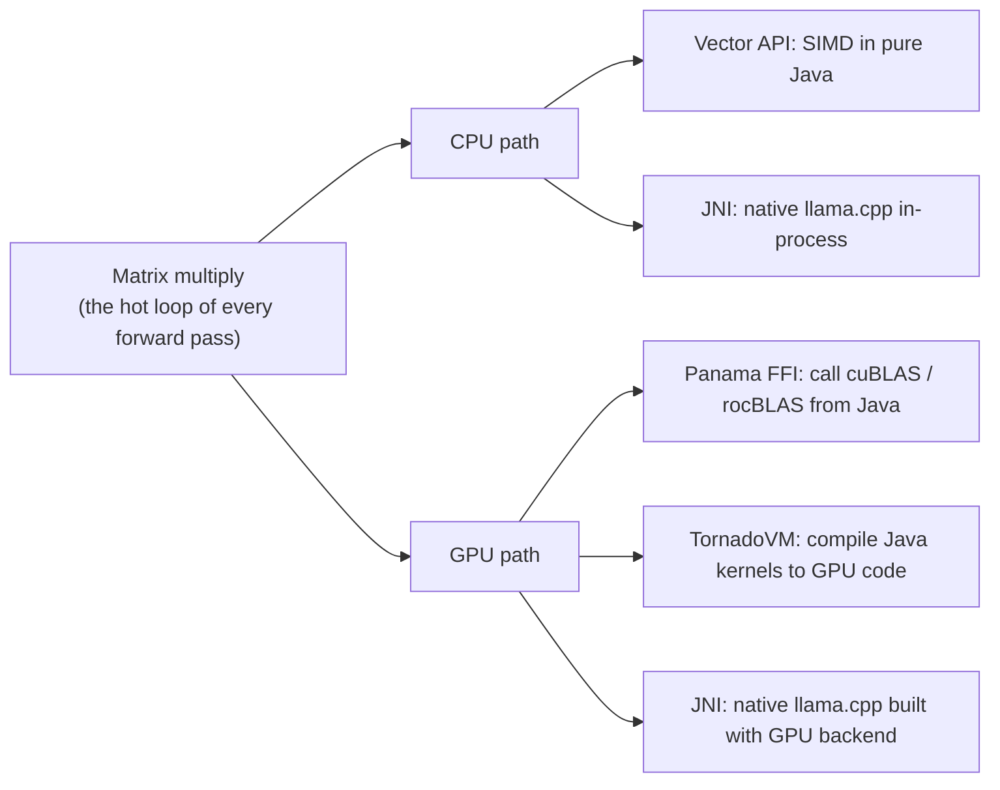

(ch-08)=
# 8. Same Matrix Multiply, Different Hardware: A Tour of JVM Inference Engines

Lets dig in why it seems like Python dominates ML. And why that shouldn't trap your Java stack.
Python became ML's default language for reasons that are historical and pragmatic, not technical superiority for every task:

- **Research velocity.** Notebooks (Jupyter) let researchers iterate on ideas interactively, without a build step.
- **NumPy and friends came first.** A mature numerical computing ecosystem (NumPy, then PyTorch/TensorFlow) accumulated a decade-plus head start and network effects, because papers publish code in Python, so the next paper's code is also in Python.
- **The GIL doesn't matter as much as you'd think for training**, because the actual heavy lifting (matrix multiplication) happens inside C++/CUDA kernels that Python merely orchestrates. Python is the glue, not the engine.

None of this means your production Java service needs a Python subprocess bolted onto it. That's a common but avoidable architectural compromise: spinning up a Flask microservice just to call a model, adding a network hop, a second deployment pipeline, a second dependency-management story, and a second set of on-call runbooks for a team that otherwise lives entirely in the JVM.

## Two well-trodden paths exist today for a Java stack

### 8.1. **Talk to a model server over a standard wire protocol.**

Your Java code just becomes an HTTP client, with no Python dependency in your own deployment at all, because the model server is a separate, independently-operated process. Several genuinely different engines all converge on the same OpenAI-compatible `POST /v1/chat/completions` contract, which is worth knowing since they make very different trade-offs underneath it:

   - **llama.cpp**'s server mode (`llama-server`, documented in the [llama.cpp Server README](../rtfms.md#ref-llamacpp-server)) and **[Ollama](../rtfms.md#ref-ollama)** (which wraps llama.cpp with model management ergonomics): a single C++ process, no Python at all in the serving path.

     ```bash
     llama-server -m mistral-7b-instruct.Q4_K_M.gguf --port 8080
     ```

     ```bash
     ollama run mistral # default serves on :11434
     ```

   - **vLLM**: a Python, GPU-first engine (`vllm serve MODEL`) built specifically to maximize throughput at scale rather than run comfortably on a laptop; it's also where PagedAttention, cited in [Chapter 28](#ch-28), originated ([vLLM OpenAI-Compatible Server](../rtfms.md#ref-vllm-openai-api)).

     ```bash
     vllm serve mistralai/Mistral-7B-Instruct-v0.3 # serves by default on :8000
     ```

   - **Hugging Face's Text Generation Inference (TGI)**: an unusual split architecture, a Rust HTTP router handling batching and scheduling, talking over gRPC to a separate Python process that actually runs the model, OpenAI-compatible since its "Messages API" ([TGI Messages API](../rtfms.md#ref-tgi-openai-api)).

     ```bash
     text-generation-launcher --model-id mistralai/Mistral-7B-Instruct-v0.3 --port 8080
     ```

   - **LocalAI**: a Go binary explicitly built around drop-in OpenAI (and Anthropic) API compatibility, with model backends installed on demand as separate processes over gRPC rather than compiled into one binary ([LocalAI Overview](../rtfms.md#ref-localai-openai-api)).

     ```bash
     local-ai run mistral-7b-instruct:q4_k_m # by default serves on :8080
     ```

   - **Juno**: a Java engine designed as a distributed system, with a GPU path (CUDA/ROCm) and a pure-Java CPU path, compared in section 8.2 below. Its `--api-port` flag starts the **[OpenAI-compatible server](../rtfms.md#ref-juno-openai-api)**.

     ```bash
     ./juno local --model-path /models/mistral-7b-instruct.Q4_K_M.gguf --api-port 8080
     ```

   Every one of these is a different language, a different process architecture, and a different set of trade-offs, yet from your Java client's perspective they're indistinguishable: same JSON contract, same `base_url` swap. Getting each one running for the first time takes one command (shown above), and relying on plain, rock-solid HTTP, the Java side doesn't care which one it posts to:

   ```java
   static String post(String url, String body) throws Exception {
       var request = HttpRequest.newBuilder(URI.create(url))
           .header("Content-Type", "application/json")
           .POST(HttpRequest.BodyPublishers.ofString(body)).build();
       return HttpClient.newHttpClient().send(request,
           HttpResponse.BodyHandlers.ofString()).body();
   }

   var body = """
      {"model": "local-model", "messages": [{"role": "user", "content": "write code.."}]}
      """;

   System.out.println(post("http://localhost:8080/v1/chat/completions", body));
   ```

   Six different servers, including Python's vLLM and the JVM-native Juno, one Java client. [Chapter 17](#ch-17) covers what this happy path skips: streaming, vendor-specific fields, and what happens when a backend silently ignores a parameter you thought you'd set.

### 8.2. **Run inference inside the JVM itself, with no subprocess at all.**

The model becomes a library on your classpath: one process, one deployment pipeline, one set of metrics, and `model.chat(...)` is a method call instead of an HTTP round trip. This used to sound like a research toy. It no longer is, because two JDK features made it practical: the **Vector API** ([JEP 448](../rtfms.md#ref-jep-vector-api), still behind `--add-modules jdk.incubator.vector`) compiles Java loops to SIMD instructions, and the **Foreign Function & Memory API** ([JEP 454](../rtfms.md#ref-jep-ffm), `java.lang.foreign`, also known as Panama) lets you memory-map a multi-gigabyte weights file off-heap and call native GPU libraries without JNI glue.

   An LLM forward pass is, at its core, a lot of matrix-times-vector multiplications ([Chapter 5](#ch-05)), so the interesting question for each engine is *how it gets those multiplications onto fast hardware*. Most engines are not a single trick: they have a **CPU path** and, optionally, a **GPU path**, and they pick a technique for each. Today's JVM toolbox looks like this:



   With that toolbox in mind, let's compare the most recent engines that run LLM inference on the JVM. Each row shows how one engine handles the hot loop on CPU and on GPU, followed by what you should know before adopting it: the model formats it reads, and what you have to ship alongside it.

   | Engine | CPU path | GPU path | Worth knowing |
   |---|---|---|---|
   | [**JLama**](../rtfms.md#ref-jlama-readme) | Vector API (SIMD), optional native module | none documented | Embeds in any Java app via Maven (`jlama-core`), ships a CLI with an OpenAI-compatible `restapi` command, and has a LangChain4j integration. Loads Hugging Face SafeTensors models, with pre-quantized variants published by its author |
   | [**Llama3.java**](../rtfms.md#ref-llama3-java) | Vector API (SIMD) | none | The whole engine is a single Java file with no dependencies, parses GGUF directly, runs with `jbang`, and supports GraalVM Native Image with AOT model preloading for fast start-up. Born as a teaching and compiler-tuning project, presented at Devoxx Belgium 2024 |
   | [**jitLLM**](../rtfms.md#ref-jitllm) | lightweight Java CPU implementation (`onGPU(false)`, per the related GPULlama3.java README) | TornadoVM compiles Java kernels for the GPU | "Java Inference Tornado toolkit": GGUF models (Llama 3, Mistral, Qwen, Phi-3, Granite, Gemma, DeepSeek-R1-Distill and more per its site), official LangChain4j and Quarkus integrations, plain Maven artifacts for JDK 21 and 22+ |
   | [**Juno**](../rtfms.md#ref-juno-jvm-embedding) | pure-Java CPU fallback, with quantized weights | Panama FFI into CUDA (cuBLAS) and ROCm (rocBLAS) | Reads GGUF directly; picks CUDA, then ROCm, then CPU at startup. Supports several model families and adds new ones regularly. Currently supported: LLaMA 3, Mistral, TinyLlama / Zephyr, Phi-3 and 3.5. Under development: the Qwen family (2, 2.5, 3 dense/MoE, 3.5). Unlike the engines above, it also supports fine-tuning, and it is designed as a distributed system with pipeline/tensor parallelism. Embeds via Maven as well. |
   | [**java-llama.cpp**](../rtfms.md#ref-java-llama-cpp) | JNI into the real llama.cpp | the same JNI bridge, if you built llama.cpp with a GPU backend | Not pure Java: you ship native libraries per platform, but you get llama.cpp's speed and format coverage as a Maven dependency. Native memory is not managed by the GC, so close the model (`AutoCloseable`) |

   Juno goes one step further on the training side. Its embedded fine-tuning math can train a LoRA adapter on the GPU, not only serve a model, so the same JVM process that answers requests can also adapt the model, with no Python training stack involved ([Juno training guide](../rtfms.md#ref-juno-training-guide)). Among the engines in this table, it is the only one that trains at all; the rest are inference-only.

   The GPU column contains two different bets, and it is worth comparing them directly. **[TornadoVM](../rtfms.md#ref-tornadovm)** takes plain Java code and compiles it to GPU kernels at runtime. One codebase can target several back ends and the kernels stay readable Java, but the engine runs under the TornadoVM SDK and launcher, and its speed depends on what that compiler generates. **[Panama FFI](../rtfms.md#ref-project-panama)** involves no compiler at all: the engine calls the vendor's own libraries (cuBLAS on NVIDIA, rocBLAS on AMD) straight from standard Java, so the heavy matrix kernels are the ones the vendors have tuned for years. The price is one binding per vendor and a matching driver stack on the host. Both sit on top of the CPU-side Vector API rather than replacing it.

   So when you compare engines, ask not only *which model families can it run?* but also *what does it do with the hardware?*, because the second answer decides whether the model meets your performance needs.

   Let's see what "inference as a library call" looks like there, engine by engine.

   First **JLama**, which loads a pre-quantized model directory and generates in a few lines ([JLama README](../rtfms.md#ref-jlama-readme)). Download the model once with `jlama download tjake/TinyLlama-1.1B-Chat-v1.0-Jlama-Q4`, and run your application with `--add-modules jdk.incubator.vector --enable-preview`:

```java
AbstractModel m = ModelSupport.loadModel(
        new File("models/TinyLlama-1.1B-Chat-v1.0-Jlama-Q4"), DType.F32, DType.I8);

PromptContext ctx = m.promptSupport().get().builder()
        .addUserMessage("write code..")
        .build();

Generator.Response r = m.generate(UUID.randomUUID(), ctx, 0.0f, 256, (token, ms) -> {});
System.out.println(r.responseText);
```

   Then **Llama3.java**, the smallest possible start. It is not a library but a single source file, run straight from the command line (Java 21+ is required for the memory-mapping API):

```bash
jbang Llama3.java --model Llama-3.2-1B-Instruct-Q8_0.gguf --chat
```

   Then **jitLLM**, as exposed through LangChain4j ([jitLLM documentation](../rtfms.md#ref-jitllm)); note that switching GPU on or off is one builder flag:

```java
JitLLMChatModel model = JitLLMChatModel.builder()
    .modelPath(modelPath)
    .temperature(0.9)
    .topP(0.9)
    .maxTokens(2048)
    .onGPU(true)              // GPU execution through TornadoVM
    .build();
```

   And finally **Juno**, which reads the [GGUF](https://github.com/ggml-org/ggml/blob/master/docs/gguf.md) file directly and talks to CUDA/ROCm through Panama, with no JNI wrapper library and no separate process to keep alive:

```java
try (JunoPlayer player = JunoPlayer.builder(Path.of("/models/model.gguf"))
        .nodeCount(1).useGpu(true).build()) {
    var result = player.chat(List.of(ChatMessage.user("write code..")));
    System.out.println(result.text());
}
```

   *(the `JunoPlayer` builder and `.chat()` facade shown above, [Juno Documentation §1.3](../rtfms.md#ref-juno-jvm-embedding))*

   **Going beyond one machine.** The in-process route does not end on a laptop. Of the engines compared here, Juno ships its own AWS cluster lifecycle as a set of shell scripts: `juno-deploy.sh` with `setup`, `start`, `stop`, `teardown`, and `status` commands. A single `setup` provisions the EC2 nodes from a prebuilt image with CUDA or ROCm drivers already installed, downloads the model, starts the nodes as `systemd` services, and optionally copies a trained LoRA adapter to every node. Instance type, node count, and pipeline or tensor parallelism ([Chapter 30](#ch-30)) are command-line options, so the Java process you tested locally is the one that runs in the cloud. One practical detail: new AWS accounts often have a GPU vCPU quota of zero, so request an increase before the first `setup` ([Juno Documentation §6.2](../rtfms.md#ref-juno-aws-deployment)).

   **What you take on when the model lives in your JVM.** In-process is not free. The weights sit in your process's address space, so a 4 GB `Q4_K_M` model ([Chapter 16](#ch-16)) is 4 GB of *off-heap* memory that `-Xmx` does not limit and a heap dump will not show. Loading takes seconds, so treat it like warming a cache rather than like constructing an object. A native crash (JNI-based engines) or an out-of-memory kill takes your whole service down with it, where a separate server process would only take itself down. And GPU engines need compatible drivers on the host, so "pure Java" stops meaning "runs anywhere" the moment you ask for a GPU. None of these is a reason to avoid the approach, but they are the questions to answer before you pick between path 1 and path 2.

The takeaway isn't "Python bad, Java good": it's that **the language the model was trained in has nothing to do with the language that must serve it.** A GGUF file is a portable, language-agnostic weights format. Pick the serving path (subprocess-via-HTTP, or in-process-via-JVM) based on your operational constraints, not habit.

Notice what the tables above does not say: it makes no speed claims. Throughput really depends on your GPU's/CPU's memory bandwidth, the quantization level and size of the model file. However in [Chapter 26](#ch-26) we will be doing detailed testing of several approaches listed above.

**Further reading:**
- OpenJDK. [JEP 448: Vector API (Sixth Incubator)](https://openjdk.org/jeps/448) and [JEP 454: Foreign Function & Memory API](https://openjdk.org/jeps/454) ([rtfms](../rtfms.md#ref-jep-vector-api), [rtfms](../rtfms.md#ref-jep-ffm)) - the two platform features that make pure-Java inference fast enough to be useful. The Vector API has been re-incubated in several JDK releases, so check the current JEP for your JDK version;
- The [GGUF](https://github.com/ggml-org/ggml/blob/master/docs/gguf.md) file format specification.

_References:_
- ggml-org. *llama.cpp*, [`tools/server/README.md`](https://github.com/ggml-org/llama.cpp/blob/master/tools/server/README.md) ([rtfms entry](../rtfms.md#ref-llamacpp-server)) - the canonical reference for `llama-server`: build options, every CLI flag, and the OpenAI-compatible endpoints used by the examples above. Flags move between releases, so treat the live README as authoritative over any snippet in this book;
- Ollama: [github.com/ollama/ollama](https://github.com/ollama/ollama) ([rtfms entry](../rtfms.md#ref-ollama));
- vLLM Project. [OpenAI-Compatible Server](https://docs.vllm.ai/en/latest/serving/online_serving/openai_compatible_server/) ([rtfms](../rtfms.md#ref-vllm-openai-api));
- Hugging Face. [Text Generation Inference: Messages API](https://huggingface.co/docs/text-generation-inference/en/messages_api) ([rtfms](../rtfms.md#ref-tgi-openai-api));
- Di Giacinto, E. et al. [LocalAI Overview](https://localai.io/docs/overview/index.html) ([rtfms](../rtfms.md#ref-localai-openai-api));
- the other "talk to it over HTTP" options from path 1, each documenting the shared wire format and its own deviations Juno's side of the same contract is in [§5.2 OpenAI-Compatible API](../rtfms.md#ref-juno-openai-api);
- Luciani, T. J. (2024). [*Jlama: A modern LLM inference engine for Java*](https://github.com/tjake/Jlama) ([rtfms](../rtfms.md#ref-jlama-readme));
- Maven coordinates, CLI, supported model families, and required JVM flags. For context, see InfoQ (2024), [JLama: The First Pure Java Model Inference Engine Implemented With Vector API and Project Panama](https://www.infoq.com/news/2024/05/jlama-llm-inference-java);
- Peterssen, A. [*Llama3.java*](https://github.com/mukel/llama3.java) ([rtfms](../rtfms.md#ref-llama3-java)) - the single-file engine; reading it is the fastest way to see a complete transformer forward pass, GGUF parser and tokenizer in one place. Its README credits Karpathy, A., [*llama2.c*](https://github.com/karpathy/llama2.c) ([rtfms](../rtfms.md#ref-llama2c)) as the ancestor of the idea;
- TornadoVM project. [*jitLLM*](https://www.tornadovm.org/jitllm) ([rtfms](../rtfms.md#ref-jitllm)) and [*TornadoVM Documentation*](https://tornadovm.readthedocs.io/en/latest/) ([rtfms](../rtfms.md#ref-tornadovm)) - GPU inference from plain Java; artifact versions and supported models change quickly, so check the documentation pages before adding a dependency;
- Kherud. [*java-llama.cpp*](https://github.com/kherud/java-llama.cpp) ([rtfms](../rtfms.md#ref-java-llama-cpp)) - JNI bindings for llama.cpp, the pragmatic choice when you want llama.cpp's exact behavior inside a JVM and accept shipping native libraries;
- *Juno Documentation*, [§1.2 Quickstart: Local Player](../rtfms.md#ref-juno-quickstart-local), [§1.3 Quickstart: JVM Embedding](../rtfms.md#ref-juno-jvm-embedding) and [§6.2 AWS Deployment](../rtfms.md#ref-juno-aws-deployment) - the in-process facade used in the example above, and the scripts that take it to an AWS cluster. Juno is maintained by the author of this book; the comparison table above is deliberately limited to what each project documents about itself.

---

[← Chapter 7: What Is a Language Model? Tokens, Context Windows, and Why Chat Bots Feel Magical](#ch-07) &nbsp;|&nbsp; [Table of Contents](../index.md) &nbsp;|&nbsp; [Chapter 9: Vectors and Similarity, Not Just Embeddings: Cosine, Dot Product, and Why "Closeness" Works →](#ch-09)
