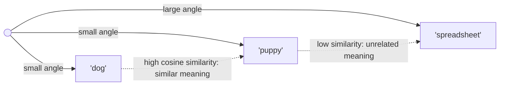

(ch-09)=
# 9. Vectors and Similarity, Not Just Embeddings: Cosine, Dot Product, and Why "Closeness" Works
Before [Chapter 10](#ch-10) introduces embeddings properly, you need one geometric idea: numbers arranged as a vector can represent *meaning*, and the distance between two vectors can represent *similarity of meaning*.

A vector here is just what it is in any graphics or physics code you've written: an ordered array of numbers, `double[]` or `float[]`, but instead of representing a position in 3D space, it represents a position in a space with hundreds or thousands of dimensions, where "nearby" means "semantically similar."

That's a strange claim to take on faith, and the last section of this chapter gets into why it holds at all. First, though, it helps to pin down how "nearby" is actually computed, because the arithmetic itself is unglamorous, the same multiply-and-sum you'd already write to compute a lighting angle or a projection in a graphics or physics routine.

Two standard ways to measure "nearby":

**Dot product**: multiply corresponding elements and sum:

```java
double dot(double[] a, double[] b) {
    double sum = 0;
    for (int i = 0; i < a.length; i++) sum += a[i] * b[i];
    return sum;
}
```

**Cosine similarity**: the dot product normalized by each vector's length, so it measures the *angle* between vectors, ignoring their magnitude:

```java
double cosineSimilarity(double[] a, double[] b) {
    double dot = dot(a, b), normA = 0, normB = 0;
    for (int i = 0; i < a.length; i++) { normA += a[i]*a[i]; normB += b[i]*b[i]; }
    return dot / (Math.sqrt(normA) * Math.sqrt(normB));
}
```

Cosine similarity returns a value from -1 (opposite meaning) to 1 (identical direction, i.e. same meaning), with 0 meaning unrelated (in theory; fact 7 below explains why real models rarely give exactly that). It's the default choice for text similarity because it cares about *direction* (what the text is about) rather than *magnitude* (how long the text is).



Why should this work at all? Why would "meaning" correspond to geometric direction? Because these vectors (called **embeddings**, covered fully next chapter) are *trained* so that words and sentences used in similar contexts end up pointing in similar directions, an empirical finding first demonstrated at scale by [Mikolov et al. (2013)](../references.md#ref-word2vec) with word2vec. The underlying idea is older than neural networks: linguists argued in the 1950s that a word's meaning shows in the contexts it appears in, as in Firth's line that you shall know a word by the company it keeps ([Harris, 1954](../references.md#ref-harris-distributional); [Firth, 1957](../references.md#ref-firth-synopsis)), and document vectors compared by angle date back to [Salton et al. (1975)](../references.md#ref-vsm). It's an emergent property of training on massive text, not something anyone hand-designed, much like how a hash function is designed to scatter similar-looking inputs apart, an embedding model is trained to cluster similar-*meaning* inputs together.

## Eight Small Facts About Vectors and Closeness

The following facts are not needed to *use* embeddings, but each one explains a behavior that otherwise looks like a bug. They are written in plain words on purpose.

**1. In many dimensions, almost everything is at a right angle.** Pick two random directions in 3D and they often point somewhere similar. Pick two random directions in 768 dimensions and they are almost always nearly perpendicular, with a cosine very close to 0. Run this in Java and see:

```text
// output of a small Java program: two random unit vectors, 2,000 pairs per row
dim=   3  avg |cos|=0.506  max |cos|=1.000
dim= 100  avg |cos|=0.079  max |cos|=0.373
dim= 768  avg |cos|=0.029  max |cos|=0.132
dim=1536  avg |cos|=0.020  max |cos|=0.090
```

The typical size of a random cosine shrinks like `1/sqrt(dimensions)`. That is why a cosine of 0.5 between two real embeddings is a loud signal: random noise at that size would be extraordinarily rare. High dimensions also leave room for a huge number of directions that are all nearly perpendicular to each other, which is how one vector space can hold thousands of different topics without them crowding each other.

**2. Normalize once, and cosine becomes a plain dot product.** If every vector is scaled to length 1 when you store it, the length terms in the cosine formula are both 1 and vanish. Search then needs only the multiply-and-sum loop, with no square roots at query time. This is why many vector stores keep normalized vectors, and why a dot-product index and a cosine index give the same ranking for such data.

**3. For unit vectors, "angle" and "straight-line distance" rank things identically.** The identity is `distance² = 2 - 2 × cosine`. So the closest vector by cosine is also the closest by Euclidean distance. You can verify it in two lines of Java; the two numbers match to the last digit. The practical lesson: don't agonize over cosine versus Euclidean for normalized embeddings, but *do* check whether your model expects normalized vectors, because with unnormalized ones a long vector can beat a better-aligned short one on raw dot product.

**4. Distance gets blurry in the dark.** For random, structureless points in very high dimensions, the nearest and the farthest neighbor end up at almost the same distance. This is the famous "curse of dimensionality", analysed in [Beyer et al. (1999)](../references.md#ref-nn-meaningful). Real embeddings escape the curse because real text is not random: meaning is organized, so the data really lives near a much smaller shape than 768 dimensions suggest. That is also why approximate indexes like HNSW ([Chapter 11](#ch-11)) work on real data.

**5. You can squash vectors, a little, and keep the neighborhood.** The Johnson-Lindenstrauss lemma ([Johnson & Lindenstrauss, 1984](../references.md#ref-jl-lemma)) says that a set of points can be projected into far fewer dimensions with only small changes to the distances between them. A newer trick, Matryoshka embeddings ([Kusupati et al., 2022](../references.md#ref-matryoshka)), trains a model so the *first* 64, 128, 256... numbers of a vector are already a usable smaller embedding, like nested Russian dolls. Some embedding models are published this way, which lets you trade accuracy for memory by simply cutting the array.

**6. Size adds up quickly.** One 1,536-dimension `float[]` is 1,536 × 4 bytes = 6 KB. A million documents is about 6 GB of raw vectors, before any index overhead. The same bytes-per-number thinking that motivates quantization in [Chapter 16](#ch-16) is why vector stores quantize or truncate their vectors too.

**7. "Closeness" is not the same as "same topic", and the scale is model-specific.** Many models squeeze their vectors into a narrow cone of the space (researchers call this *anisotropy*; see [Ethayarajh, 2019](../references.md#ref-anisotropy), who studied contextual language-model representations), so two unrelated texts may still score 0.6 or 0.7, not 0. Different models use different parts of the range. Never copy a magic threshold like "above 0.8 means relevant" from one model to another; look at the score distribution for your own data. Rankings (this one is closer than that one) are far more trustworthy than absolute scores. Also remember that `1 - cosine` is a handy "distance" for sorting, but strictly speaking it is not a true metric, because it can break the triangle inequality.

**8. Some vectors become popular for no good reason.** In high dimensions a few "hub" points show up in the top-K lists of many unrelated queries, a phenomenon called *hubness* ([Radovanović et al., 2010](../references.md#ref-hubness)). If one document keeps appearing in your RAG results ([Chapter 18](#ch-18)) for questions it has nothing to do with, this is a suspect.

**Bonus: arithmetic with meaning.** In the word2vec space, the offset from `man` to `woman` points in nearly the same direction as the offset from `king` to `queen`, so `king - man + woman` lands near `queen` ([Mikolov, Yih & Zweig, 2013](../references.md#ref-linguistic-regularities)). It works best as a party trick: the effect is approximate, and implementations usually exclude the input words from the answer list. But it shows that *directions*, not only positions, carry meaning.

This one idea, turning things into vectors and measuring closeness with cosine or dot product, is the mathematical foundation underneath semantic search, recommendation systems, RAG ([Chapter 18](#ch-18)), and vector databases ([Chapter 11](#ch-11)). Once it clicks, a large fraction of "AI-powered search" products stop looking like magic and start looking like an indexing problem you already know how to reason about.

**Further reading:**

*Where vector closeness comes from*

- Mikolov, T., Chen, K., Corrado, G., & Dean, J. (2013). [Efficient Estimation of Word Representations in Vector Space](https://arxiv.org/abs/1301.3781). arXiv:1301.3781 ([References](../references.md#ref-word2vec)) - the word2vec paper establishing that training on context produces geometrically meaningful embeddings.
- Mikolov, T., Yih, W., & Zweig, G. (2013). [Linguistic Regularities in Continuous Space Word Representations](https://aclanthology.org/N13-1090/). *NAACL-HLT 2013*, 746-751 ([References](../references.md#ref-linguistic-regularities)) - relationships between words appear as consistent *directions*, the source of the `king - man + woman ≈ queen` example.
- Harris, Z. S. (1954). [Distributional Structure](https://doi.org/10.1080/00437956.1954.11659520). *Word*, 10(2-3), 146-162 ([References](../references.md#ref-harris-distributional)) · Firth, J. R. (1957). A synopsis of linguistic theory, 1930-1955. In *Studies in Linguistic Analysis*, 1-32. Oxford: Philological Society ([References](../references.md#ref-firth-synopsis)) - the linguists' "distributional hypothesis": words used in similar contexts have similar meanings. It is the intuition word2vec turned into an algorithm, and the answer to why meaning should be geometry at all.
- Salton, G., Wong, A., & Yang, C. S. (1975). [A Vector Space Model for Automatic Indexing](https://doi.org/10.1145/361219.361220). *Communications of the ACM*, 18(11), 613-620 ([References](../references.md#ref-vsm)) - documents as vectors, similarity as the angle between them, decades before the term "AI search".

*The geometry of high dimensions*

- Beyer, K., Goldstein, J., Ramakrishnan, R., & Shaft, U. (1999). [When Is "Nearest Neighbor" Meaningful?](https://doi.org/10.1007/3-540-49257-7_15) In *Database Theory - ICDT'99*, LNCS 1540, 217-235 ([References](../references.md#ref-nn-meaningful)) - why distances lose contrast in high dimensions for unstructured data, and when they do not (fact 4).
- Johnson, W. B., & Lindenstrauss, J. (1984). [Extensions of Lipschitz mappings into a Hilbert space](https://doi.org/10.1090/conm/026/737400). *Contemporary Mathematics*, 26, 189-206 ([References](../references.md#ref-jl-lemma)) - the original random-projection lemma behind fact 5. A technical paper; lecture-note treatments are a gentler start.
- Kusupati, A. et al. (2022). [Matryoshka Representation Learning](https://proceedings.neurips.cc/paper_files/paper/2022/hash/c32319f4868da7613d78af9993100e42-Abstract.html). *NeurIPS 2022*. arXiv:2205.13147 ([References](../references.md#ref-matryoshka)) - embeddings whose leading dimensions form usable smaller embeddings, a practical way to cut memory and search cost (fact 5).
- Ethayarajh, K. (2019). [How Contextual are Contextualized Word Representations?](https://arxiv.org/abs/1909.00512) *EMNLP-IJCNLP 2019*. arXiv:1909.00512 ([References](../references.md#ref-anisotropy)) - shows that vectors from ELMo, BERT and GPT-2 crowd into a narrow cone (fact 7).
- Radovanović, M., Nanopoulos, A., & Ivanović, M. (2010). [Hubs in Space: Popular Nearest Neighbors in High-Dimensional Data](https://jmlr.org/papers/v11/radovanovic10a.html). *JMLR*, 11(86), 2487-2531 ([References](../references.md#ref-hubness)) - why some vectors become neighbors of everything (fact 8).

*Next in this book:* [Chapter 10](#ch-10) turns text into these vectors, and [Chapter 11](#ch-11) shows how to search millions of them without comparing against every one.

---

[← Chapter 8: Same Matrix Multiply, Different Hardware: A Tour of JVM Inference Engines](#ch-08) &nbsp;|&nbsp; [Table of Contents](../index.md) &nbsp;|&nbsp; [Chapter 10: Embeddings 101: Turning Text into Vectors Your Services Can Search →](#ch-10)