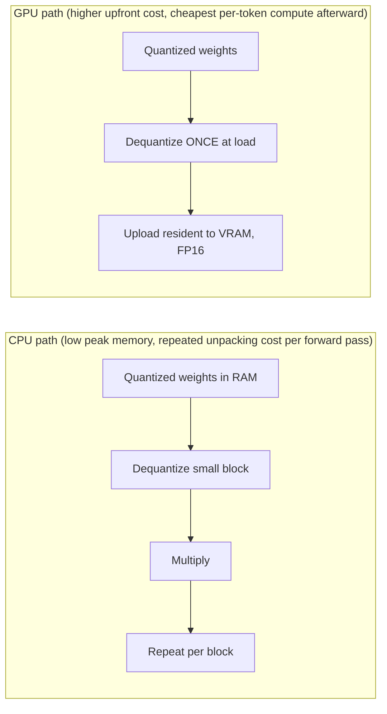

(ch-26)=
# 26. CPU vs GPU Inference: When CUDA/ROCm Matter and When Quantized CPU Wins
The forward pass ([Chapter 5](#ch-05)) is, at its core, a long sequence of matrix-vector multiplications. GPUs are purpose-built for exactly this kind of massively parallel, regular numerical workload: thousands of simple cores doing the same arithmetic operation on different data simultaneously, which is precisely what multiplying a weight matrix by an activation vector looks like at the hardware level. CPUs, by contrast, have far fewer, more general-purpose cores optimized for branching, varied instruction streams, and low-latency single-threaded work.

This isn't an abstract distinction: it shows up directly in inference server design. Two GPU vendor paths dominate today, both reachable from pure Java without JNI wrapper libraries via `java.lang.foreign` (Panama FFI), the same low-overhead native-call mechanism used to talk to CUDA and ROCm directly:

| Vendor | Library | Java binding approach |
|---|---|---|
| NVIDIA | CUDA 12.x + cuBLAS | `java.lang.foreign.Linker` resolves `libcudart.so`/`libcublas.so` directly: no JNI wrapper |
| AMD | ROCm 6+/7+ + rocBLAS | Same Panama FFI approach, resolving `libamdhip64.so`/`librocblas.so` |

A well-designed inference engine auto-selects the best available backend at startup (CUDA first, then ROCm, then CPU quantized fallback) and falls back gracefully if GPU memory allocation fails partway through loading a model, rather than crashing outright. This is a resilience pattern worth internalizing regardless of the specific stack: **treat GPU acceleration as an optimization with a correctness-preserving fallback, not a hard dependency the system can't function without.**

**When GPU wins decisively:** large models, high-throughput serving with many concurrent requests, and any workload where raw tokens-per-second matters more than infrastructure simplicity. The parallelism advantage compounds with model size, because bigger matrices mean more work to parallelize.

**When quantized CPU inference is the right call, not just a fallback:**

- **Small-to-medium models** (roughly up to a few billion parameters) at aggressive quantization (`Q4_K` and similar, [Chapter 16](#ch-16)) run at genuinely usable speeds on ordinary CPU hardware: this is precisely why quantized GGUF became the standard local-inference format.
- **Low concurrency, cost-sensitive deployments.** A `2 vCPU / 8 GB RAM` cloud instance with no GPU is dramatically cheaper than any GPU instance, and for single-user or low-traffic scenarios, CPU throughput is entirely adequate.
- **Simplicity and portability.** No GPU driver installation, no CUDA/ROCm version matching headaches, no VRAM budgeting: a real operational win, especially for on-prem deployments where you don't control the hardware fleet.
- **Development and testing.** Nobody should need a GPU to run integration tests against a stub or small model locally.

A useful mental model for the actual matmul hot path on CPU: **lazy, block-wise dequantization.** Rather than dequantizing an entire weight matrix to full precision up front (which would briefly spike memory usage back to something like the original FP32 footprint, defeating much of quantization's purpose), a well-tuned CPU path dequantizes one small block (say, 256 elements) at a time, right inside the multiplication loop, keeping peak live memory for that operation down around a kilobyte instead of tens of megabytes, at the cost of doing that unpacking work repeatedly on every forward pass rather than once at load time. GPU paths typically make the opposite trade: dequantize once, upload the result resident in device memory (often as FP16) at load time, and pay that cost once instead of on every token.

## Making the Hot Loop Faster: Where the Speed Actually Comes From

Before comparing techniques, it helps to know *which* multiplication you are speeding up, because LLM inference contains two very different ones.

- **Generating a token (decode)** multiplies every weight matrix by a single vector. Each weight is read from memory, used for one multiply-add, and then forgotten. The CPU or GPU spends most of its time waiting for memory, not calculating. Llama3.java's author notes in the project README that inference is constrained by memory bandwidth ([Llama3.java](../rtfms.md#ref-llama3-java)), and a TornadoVM engineer's analysis of LLM inference in Java makes the same point about matrix-vector multiplications ([Papadimitriou, 2023](../rtfms.md#ref-java-llms-perf)). The general framework for this question, "is this computation limited by memory or by arithmetic?", is the Roofline model ([Williams et al., 2009](../references.md#ref-roofline)).
- **Reading the prompt (prefill)** multiplies the same weights by *many* vectors at once, a true matrix-times-matrix product. Each weight loaded from memory is reused many times, so the arithmetic units become the bottleneck. This is where clever compute kernels pay off.

A back-of-envelope rule follows from the first point. Every generated token has to stream (roughly) the whole set of weights through the processor once, so decode speed cannot exceed `memory bandwidth ÷ model size`. A 7B model at `Q4_K_M` is about 4.1 GB ([Chapter 16](#ch-16)); on a machine with an illustrative 50 GB/s of memory bandwidth that is an upper bound of about 12 tokens/second, no matter how fast the arithmetic is. It is an estimate, not a benchmark, but it explains two things at once: why quantization speeds up generation (fewer bytes to move, not just less arithmetic), and why the same engine can feel fast at reading a long prompt and slow at writing the answer.

With that in mind, here is a map of the techniques available to a JVM team. The first two rows are the ones this book has leaned on; the rest are further levers worth knowing about.

| Technique | Where it runs | What it does | Reachable from Java via |
|---|---|---|---|
| **SIMD in pure Java** | CPU | Processes 8-16 floats per instruction instead of one | Vector API ([JEP 448](../rtfms.md#ref-jep-vector-api)), as in JLama and Llama3.java ([Chapter 8](#ch-08)) |
| **GPU vendor libraries** | GPU | Hand-tuned matrix kernels (cuBLAS, rocBLAS) | Panama FFI, as described above |
| **Tuned micro-kernels** | CPU | Keeps a small tile of the result in CPU registers while looping, with the loop unrolled to hide latency. Often the difference between a naive SIMD loop and a library-grade one | Written by hand with the Vector API, or taken from a native library |
| **Native BLAS libraries** (OpenBLAS, MKL and similar) | CPU | Decades of hand-written assembly for matrix multiplication, tuned per CPU model | Panama FFI to the `sgemm` entry point; no JNI glue needed |
| **[llamafile `sgemm`](../rtfms.md#ref-llamafile-sgemm) ("tinyBLAS")** | CPU | A compact C++ matmul kernel set upstreamed into llama.cpp, with improved prompt-processing speed and AVX512 support | Inherited automatically through llama.cpp and Ollama, or through [java-llama.cpp](../rtfms.md#ref-java-llama-cpp) bindings |
| **CPU matrix instructions** (Arm `i8mm`/SME, with libraries such as [KleidiAI](../rtfms.md#ref-kleidiai)) | CPU (Arm) | Instructions that multiply small *tiles* of 8-bit integers in one step, which suits quantized weights | Through llama.cpp's `ggml-cpu` backend, or the C library via FFI |
| **Java-to-GPU compilation** | GPU | Compiles ordinary Java kernels to GPU code, no CUDA source | [TornadoVM](../rtfms.md#ref-tornadovm) today ([Chapter 8](#ch-08)); [Project Babylon's HAT](../rtfms.md#ref-hat-matmul) as an OpenJDK-native, still-incubating alternative |

Three practical lessons come out of this table.

**1. For decode, shrink the bytes first.** A lower-bit quantization or a smaller model beats nearly any kernel trick, because the arithmetic units are mostly idle anyway. The block-wise dequantization above is exactly the trade of "a little extra arithmetic for far fewer bytes moved."

**2. For prefill and batching, the kernel matters.** If your workload is dominated by long prompts (RAG, [Chapter 18](#ch-18)) or by many concurrent users ([Chapter 29](#ch-29)), you are in matrix-times-matrix territory, and a tuned native kernel or a GPU gives real returns. A plain SIMD loop leaves performance on the table: one engineer's 2021 Java BLAS experiments traced the gap to native OpenBLAS to loop structure, namely the size of the register tile and the amount of unrolling, in combination with the JIT's register allocation at the time ([Henry, 2021](../rtfms.md#ref-henry-vector-api)).

**3. "Pure Java" and "fast" are separate dials.** Pure-Java kernels give you one deployment unit and no native-library headaches; calling a native BLAS through Panama gives you someone else's years of assembly tuning at the price of shipping a platform-specific library. A 2024 peer-reviewed comparison of vector-distance operations found that calling C++ from Java was faster in most of its benchmarks despite the call overhead, while the Vector API still gave a noticeable uplift when native code was not allowed ([Tomilov & Turov, 2024](../references.md#ref-tomilov-vector-api)). It measured distance computations, not full LLM matmul. Treat that as a direction, not a verdict: hardware, JDK version and matrix shape all move the answer, so profile with JFR ([Chapter 27](#ch-27)) on your own deployment target before choosing.

The practical sizing exercise, regardless of vendor stack: match model size and quantization level to your concurrency and latency requirements *before* reaching for GPU hardware by default. A surprising number of production LLM features never need a GPU at all.

**Further reading:**

*Reasoning about the bottleneck*

- Williams, S., Waterman, A., & Patterson, D. (2009). [Roofline: An Insightful Visual Performance Model for Multicore Architectures](https://doi.org/10.1145/1498765.1498785). *Communications of the ACM*, 52(4), 65-76 ([References](../references.md#ref-roofline)) - the standard way to tell whether a computation is limited by memory bandwidth or by arithmetic, which is the distinction behind decode versus prefill above.

*Matrix multiplication on the JVM*

- Tomilov, N. A., & Turov, V. P. (2024). [Evaluating the performance of Java Vector API in vector embedding operations](https://doi.org/10.18721/JCSTCS.17401). *Computing, Telecommunications and Control*, 17(4), 7-15 ([References](../references.md#ref-tomilov-vector-api)) - Vector API versus scalar Java versus native C++ called through JNI and Panama.
- Papadimitriou, M. (2023). [Java and LLMs: are we there yet?](https://medium.com/@mpapadimitriou92/java-and-llms-are-we-there-yet-300cf9418ed7) *Medium*, 19 December ([rtfms](../rtfms.md#ref-java-llms-perf)) - an engineering blog post (not peer-reviewed) profiling LLM inference in Java with the Vector API, Panama and TornadoVM against native C.
- Henry, L. (2021). [Learnings with the Vector API](https://mail.openjdk.org/pipermail/panama-dev/2021-January/011930.html). *panama-dev mailing list*, 28 January ([rtfms](../rtfms.md#ref-henry-vector-api)) - a candid look at where a Vector API matrix multiply loses to OpenBLAS and why. Dated, but the diagnosis (register tiling and unrolling) still illustrates the principle.
- Fumero, J. (2026). [Optimizing GPU Programs from Java using Babylon and HAT](https://openjdk.org/projects/babylon/articles/hat-matmul/hat-matmul). *OpenJDK Project Babylon articles*, January ([rtfms](../rtfms.md#ref-hat-matmul)) - a hands-on matrix-multiplication walkthrough showing how tiling and memory layout are tuned step by step from Java. The HAT API is still incubating; check the project page for its current state.
- OpenJDK. [JEP 448: Vector API (Sixth Incubator)](https://openjdk.org/jeps/448) and [JEP 454: Foreign Function & Memory API](https://openjdk.org/jeps/454) ([rtfms](../rtfms.md#ref-jep-vector-api), [rtfms](../rtfms.md#ref-jep-ffm)) · TornadoVM project, [TornadoVM Documentation](https://tornadovm.readthedocs.io/en/latest/) ([rtfms](../rtfms.md#ref-tornadovm)) - the platform pieces and the GPU-compilation toolkit behind the Java-side rows in the table.

*Native kernels worth knowing about*

- Tunney, J. et al. (2024). [ggml : add llamafile sgemm (#6414)](https://github.com/ggml-org/llama.cpp/pull/6414). *llama.cpp*; background: Tunney, J., [LLaMA Now Goes Faster on CPUs](https://justine.lol/matmul/) ([rtfms](../rtfms.md#ref-llamafile-sgemm)) - hand-written CPU matmul kernels integrated into llama.cpp. The speedups quoted there are the author's measurements on his own hardware.
- Arm. [KleidiAI](https://github.com/ARM-software/kleidiai) and [Optimizing Llama.cpp with Arm I8MM instruction](https://community.arm.com/arm-community-blogs/b/ai-blog/posts/optimize-llama-cpp-with-arm-i8mm-instruction) ([rtfms](../rtfms.md#ref-kleidiai)) - integer matrix-multiply instructions and micro-kernels for quantized models on Arm CPUs. Vendor material.

*Next in this book:* [Chapter 8](#ch-08) introduces the engines that use these techniques, and [Chapter 27](#ch-27) shows how to measure which one actually helps on your hardware.

---

[← Chapter 25: Merge Adapters into GGUF: Shipping One Artifact, No Sidecar Weights](#ch-25) &nbsp;|&nbsp; [Table of Contents](../index.md) &nbsp;|&nbsp; [Chapter 27: Profiling LLM Workloads with JFR: Matmul, Forward Pass, and Tokens/sec →](#ch-27)